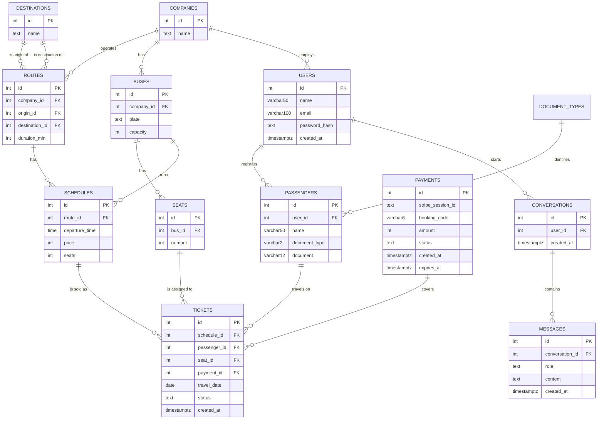
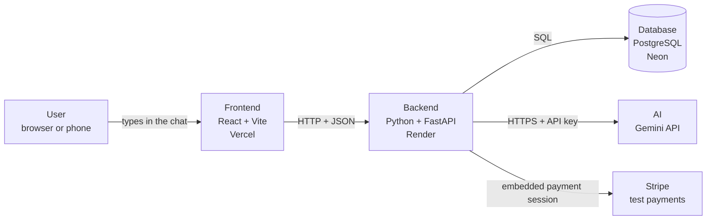
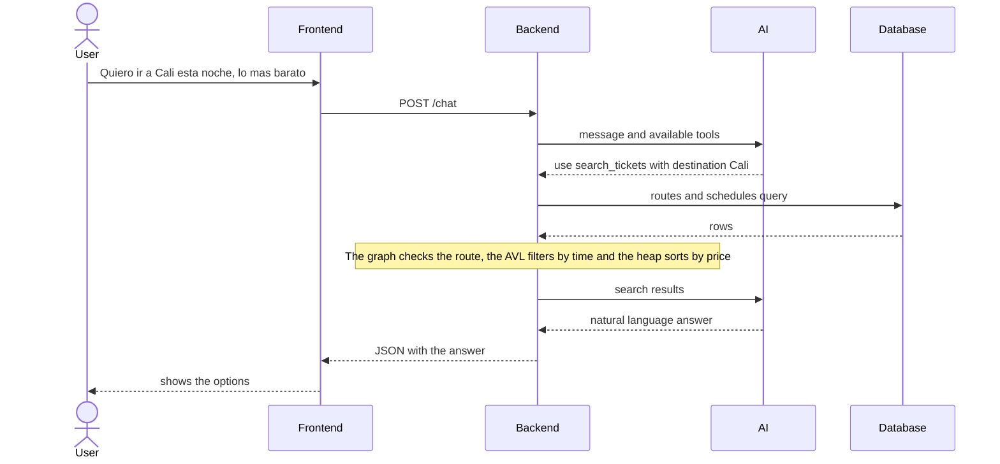

# TerminAPP - Backend

A chat-based platform to look up and buy bus tickets from the Pasto bus terminal (Terminal de Transportes de Pasto, Colombia).
Final project for Data Structures (Estructuras de Datos) - Universidad Cooperativa de Colombia, Pasto campus.

## Case study

**The problem.** To find out which buses leave the Pasto bus terminal, at what time and for how much, people today have to go to the terminal, call each company, or check several ticket websites that do not always agree. The terminal's official website lists the companies and destinations, but not the schedules or fares in one place.

**The user.** People travelling from Pasto to towns in Nariño and to cities such as Cali, Mocoa or Bogotá: students, workers and families who need to compare options quickly and are not always used to apps.

**Why AI helps.** Users write the way they talk, for example "quiero ir a Cali esta noche, lo más barato", and the AI turns that sentence into a concrete search: destination, time and sort order. The search itself is solved by the backend data structures, and the AI returns the result in natural language and guides the purchase. Nobody has to learn filters or forms.

## Team
- Juan David Moreno
- Felipe Alejandro Cerón

## URLs
- Backend: https://terminapp-backend.onrender.com
- Frontend: https://terminapp-frontend.vercel.app
- Frontend repository: https://github.com/terminapp-pasto/terminapp-frontend

## Technologies
Python, FastAPI, PostgreSQL (Neon), Gemini (AI), Stripe (test mode), Render.

## Code layout

```
config.py            every environment variable (nothing is hardcoded)
main.py              assembles the application and plugs in the routes
routes/              HTTP routes: system, search, chat, auth, purchases, admin
services/            business logic: search, purchases, admin, catalog, users, dates, validation, database
structs/             the 10 data structures built from scratch
authentication/      utilities.py (encrypt and verify passwords) and tokens.py (JWT)
ai/                  gemini.py (provider), tools.py (tools), orchestrator.py (the chat), admin_assistant.py (admin panel AI)
payments/            stripe_client.py (embedded Stripe payment in test mode)
db/                  SQL scripts 01 to 10
tests/               automated tests
```

All code (folders, files, classes, functions, variables, comments, tables and columns) is in English.
Only the text the end user reads (the interface, error messages and the assistant's replies) is in Spanish,
because TerminAPP is used by travellers in Colombia.

## Endpoints
| Method | Route | What it does |
|---|---|---|
| GET | `/health` | Checks the database connection |
| GET | `/search?destination=Cali&date=2026-10-24&from_time=18:00&sort_by=price` | Searches the departures from Pasto on one day, with that day's free seats |
| GET | `/destinations` | Lists the destinations with routes from Pasto |
| POST | `/chat` | Receives the conversation (`{"messages": [{"role": "user", "text": "..."}]}`) and answers with the AI and the departures found |
| POST | `/register` | Creates an account (the password is stored encrypted with PBKDF2) and returns a token |
| POST | `/login` | Checks email and password and returns a JWT token valid for 24 hours |
| GET | `/me` | 🔒 Protected route: returns the user who owns the token, with its `role` (`user`, `company` or `admin`) |
| GET | `/schedules/{id}/seats?date=YYYY-MM-DD` | Seat map of a departure on a date (as many seats as its bus), with the company's seats per purchase and minutes to pay |
| GET | `/document-types` | Active document types with their rule, for the purchase form |
| POST | `/purchases` | 🔒 Holds the seats for the minutes the company chose, with one passenger per seat (`checked_bags` 0 to 2) and an optional `contact_phone` |
| POST | `/purchases/{payment_id}/pay` | 🔒 Prepares the embedded Stripe payment; reuses an open one if it exists |
| GET | `/purchases/confirm?session_id=...` | 🔒 Asks Stripe whether it was paid and confirms the tickets |
| POST | `/purchases/{payment_id}/cancel` | 🔒 Cancels an unpaid purchase and frees the seats |
| GET | `/my-tickets?order=newest` | 🔒 The user's purchase history (`newest` or `oldest`), with each booking code |
| POST | `/stripe/webhook` | Stripe calls it when a payment is completed (signed with `STRIPE_WEBHOOK_SECRET`) |

### Admin panel

🔒 Only for the `admin` and `company` roles. The admin sees and changes every company; a company employee only its own
(anything of another company answers `404`). Routes marked **admin** are only for the terminal admin. Changes use
`POST`, because CORS only allows `GET` and `POST`.

| Method | Route | What it does |
|---|---|---|
| GET | `/admin/companies` | Companies with their settings and how many buses, routes and departures they have |
| POST | `/admin/companies` | **admin**: adds a company |
| POST | `/admin/companies/{id}/settings` | `max_seats_per_purchase` (1 to 10) and `reservation_minutes` (5 to 30) |
| GET / POST | `/admin/buses` | Lists buses / adds one with its seats (`plate` like `TRP-101`, `capacity` 10 to 60) |
| GET | `/admin/destinations` | Every town |
| GET / POST | `/admin/routes` | Routes with their departures / adds a route from Pasto (only the admin can add a new town) |
| POST | `/admin/routes/{id}/price` | Same price for every departure of the route |
| POST | `/admin/departures` | Adds a departure (`route_id`, `departure_time`, `price`, `bus_id`) |
| POST | `/admin/departures/{id}` | Changes `price`, `bus_id` (only while no seat is sold) or `active` (on sale or not) |
| GET | `/admin/occupancy?date=YYYY-MM-DD` | Sold, held and free seats of every bus that day, and the revenue |
| POST | `/admin/assistant` | AI that looks things up and prepares changes; it returns `actions` that the panel confirms |
| GET / POST | `/admin/document-types` | **admin**: every document type / adds one (`code`, `name`, `min_length`, `max_length`, `allows_letters`) |
| POST | `/admin/document-types/{code}/active` | **admin**: turns a document type on or off |
| GET | `/admin/users?q=` | **admin**: finds users by name or email |
| POST | `/admin/users/{id}/role` | **admin**: `role` `user`, `company` (with `company_id`) or `admin` |

| POST | `/admin/companies/{id}` | **admin**: renames a company |
| POST | `/admin/destinations/{id}` | **admin**: renames a town everywhere |
| POST | `/admin/buses/{id}` | Changes `plate` or `capacity` (it can only shrink while no seat above the new number is sold) |
| POST | `/admin/routes/{id}` | Changes `duration_min` |
| POST | `/admin/document-types/{code}` | **admin**: edits name, lengths or letters |
| GET | `/settings` | Public texts and rules: home page, notice banner, chat greeting, footer contact, sales window, boarding time |
| GET / POST | `/admin/settings` | **admin**: every text and general rule with its limits / changes them (`{"key": value}`) |
| GET | `/admin/purchases?q=&date=` | Finds purchases by booking code, email, name or document |
| POST | `/admin/purchases/{id}/cancel` | Cancels an unpaid purchase and frees its seats |
| POST | `/admin/purchases/{id}/refund` | Gives the money of a paid purchase back through Stripe and frees its seats |

`POST /admin/departures/{id}` also accepts `departure_time`, only while the departure has no tickets for future trips.

**Everything is editable from the panel**, so a change asked in class never needs new code: the texts of the home page,
the notice banner, the footer, the sales window, unpaid purchases per traveller, the boarding time and extra
instructions for the travellers' AI chat live in the `app_settings` table (script 11; a missing key uses its default).

**The AI never changes anything by itself.** For "cámbiame el precio de Cali a 85 mil" it looks up the routes and
calls a `propose_` tool; the backend checks the price and the permissions and returns the change as an action with a
summary. Only the panel's **Confirmar** button calls the real route.

**Admin account:** the professor's test account (`TEST_ACCOUNT_EMAIL` / `TEST_ACCOUNT_PASSWORD`, shown on the login
page) is created as an admin when the backend starts, so one login opens the whole app, panel included.
With the same password, two more test accounts are created, one per role:

| Role | Email | What it sees |
|---|---|---|
| Admin | `TEST_ACCOUNT_EMAIL` (e.g. `profe@terminapp.co`) | Everything: all companies, settings, document types |
| Company | `empresa.` + that email (`empresa.profe@terminapp.co`) | The panel of `TEST_COMPANY_NAME` only (Expreso Bolivariano by default) |
| Traveler | `viajero.` + that email (`viajero.profe@terminapp.co`) | Buying tickets and Mis viajes, no panel |

Their emails can be changed with `TEST_COMPANY_ACCOUNT_EMAIL` and `TEST_TRAVELER_ACCOUNT_EMAIL`.
`ADMIN_ACCOUNT_EMAIL` and `ADMIN_ACCOUNT_PASSWORD` optionally add another admin. From the panel the admin turns
other users into company employees.

## Purchase rules
- **One passenger per seat.** Buying 3 seats asks for 3 names and 3 documents, and the same document cannot appear
  twice in one purchase.
- **Each company sets its rules** (`companies` table): how many seats one purchase may take (5 by default, up to 10)
  and how many minutes an unpaid purchase holds the seats (10 by default, 5 to 30). The deadline is saved in
  `payments.expires_at` when the seats are reserved, and opening the payment does not extend it: when it passes, the
  Stripe session (which lives at least 30 minutes, Stripe's minimum) is closed and the seats are released.
- **Price kept.** Stripe charges the price saved when the seats were reserved, even if the company changes it meanwhile.
- **Document types** live in the `document_types` table: `CC` (cédula, 5 to 10 digits), `TI` (tarjeta de
  identidad, 10 or 11 digits), `CE` (cédula de extranjería, 5 to 12 digits) and `PA` (passport, letters and digits,
  5 to 12). The admin can add more or turn one off; each one is checked with a pattern built from its lengths.
  Dots, spaces and hyphens are removed before checking (`1.085.123.456` → `1085123456`).
- **Contact phone and luggage.** A purchase may save a Colombian mobile (`3XXXXXXXXX`; `+57` and spaces are removed)
  and each passenger 0 to 2 checked bags.
- **Booking code.** Every purchase gets a random 6-character code such as `K7M2QX`, without the characters that
  are easy to confuse (O/0, I/1). It is what the passenger shows when boarding.
- **At most 2 unpaid purchases per user**, so nobody can hold half a bus without paying.
- **Validation with regular expressions** (in the frontend and again in the backend, `services/validation.py`):
  name only letters and spaces, 3 to 50 characters; document only digits, 5 to 12; email up to 100 characters;
  password 8 to 72. A huge text is rejected before it reaches the database.
- **Two people and the last seat.** Reserving locks the departure (`SELECT ... FOR UPDATE`): PostgreSQL queues (FIFO)
  the other reservations for that departure, the first one wins and the second gets "El asiento 40 acaba de ser ocupado".
  On top of that, the unique index `unique_seat_per_trip` prevents a seat from being sold twice. The test
  `test_two_people_take_the_last_seat_at_the_same_time` proves it with two reservations at the same instant.
- **Never two payments in progress for the same trip.** If the user goes back and reserves the same departure again,
  the previous pending purchase is cancelled and its Stripe session closed. When paying, an open session is reused.
- **Payments are confirmed by asking Stripe**, never by trusting that the user came back to the page.

## Security

- **Keys only in environment variables** (`.env` locally, Render in production). `.env` is in `.gitignore`, and
  Stripe always runs with test keys (`sk_test_...`).
- **Roles.** `user` (traveller), `company` (one bus company) and `admin` (the terminal). The role is read from the
  database on every request, so taking a role away works at once, and the admin cannot remove their own admin role.
- **Passwords** are stored with PBKDF2 (salted hash), never in plain text. Sessions use JWT tokens signed with
  `TOKEN_SECRET` that expire after 24 hours.
- **Rate limits** (`services/rate_limit.py`, built with our own hash table and queue): too many attempts in a row
  answer `429` with how many seconds to wait.

  | Action | Limit |
  |---|---|
  | Log in | 5 per minute |
  | Create an account | 3 per 10 minutes |
  | Chat with the AI | 10 per minute |
  | Reserve seats | 10 per 10 minutes |
  | Start a payment | 20 per 10 minutes |
- **Stripe webhook** (`POST /stripe/webhook`): the HMAC-SHA256 signature is checked with `STRIPE_WEBHOOK_SECRET`
  and events older than 5 minutes are rejected, so nobody can fake a "paid" message.
- **A late payment is never lost.** Before expiring a purchase that was paying, the backend asks Stripe; if it was
  paid it is confirmed, and if its seats were already sold to someone else the money is refunded automatically.
- **CORS** only allows the Vercel site and `http://localhost:5173`. `/health` only says whether the database answers,
  without revealing configuration.

## Running it locally
1. Copy `.env.example` to `.env` and fill in `DATABASE_URL`, `GEMINI_API_KEY`, `TOKEN_SECRET`, `STRIPE_SECRET_KEY` and `FRONTEND_URL` (never commit it).
2. Activate the environment: `.\venv\Scripts\Activate.ps1`
3. Start the server **on port 8001**, so it does not clash with other projects on port 8000:
   ```
   uvicorn main:app --reload --port 8001
   ```
4. Open http://127.0.0.1:8001/docs

## Data structures

The 10 structures are built from scratch in `structs/`, with our own linked nodes (no Python lists or dictionaries as the structure).

| # | Structure | File | What it does in TerminAPP | Complexity |
|---|---|---|---|---|
| 1 | Directed weighted graph (adjacency list) | `graph.py` | Towns as vertices and routes as edges weighted by duration; answers "is there a route from Pasto to X?" | Find vertex O(V), walk a vertex's routes O(degree) |
| 2 | Linked-node matrix | `matrix.py` | Edit distance table to fix misspelled destinations ("bodota" → Bogotá) and travel time matrix between towns | Access O(r + c); correction O(n·m·(n+m)) |
| 3 | AVL tree | `avl_tree.py` | A route's schedules sorted by time; "from 18:00 on" without checking them all | Insert and search O(log n) |
| 4 | Min-heap | `min_heap.py` | Sorts the departures found by time or by price | Insert and extract O(log n) |
| 5 | N-ary tree | `nary_tree.py` | Hierarchy terminal → companies → routes → schedules | Traversal O(n) |
| 6 | Hash table with chaining | `hash_table.py` | A bus seat map (number → FREE/TAKEN) and grouping the history by purchase | Insert, find and remove O(1) on average |
| 7 | Stack | `stack.py` | Undo: if one of several seats is already taken, the previous ones are released in reverse order | Push and pop O(1) |
| 8 | Queue | `queue.py` | Pending reservations in deadline order; those unpaid after 15 minutes expire. Also the request times of the rate limiter | Enqueue and dequeue O(1) |
| 9 | State machine | `state_machine.py` | Ticket life cycle: SELECTING → RESERVED → PAYING → PAID, or CANCELLED / EXPIRED | Transition O(t) |
| 10 | Doubly linked list | `doubly_linked_list.py` | Purchase history, walkable from newest to oldest and back | Add and remove O(1), traverse O(n) |

```mermaid
stateDiagram-v2
    [*] --> SELECTING
    SELECTING --> RESERVED: reserve
    RESERVED --> PAYING: start_payment
    PAYING --> PAYING: start_payment (resumes the open payment)
    PAYING --> PAID: confirm_payment
    RESERVED --> CANCELLED: cancel
    PAYING --> CANCELLED: cancel
    RESERVED --> EXPIRED: expire (the company's minutes, 10 by default)
    PAYING --> EXPIRED: expire (same deadline; the Stripe session is closed)
    EXPIRED --> PAID: recover_payment (Stripe says it was paid)
    CANCELLED --> PAID: recover_payment
    PAID --> CANCELLED: refund (the admin gives the money back)
    PAID --> [*]
```



### Automated tests

`tests/` has 133 tests: the 10 structures, authentication, dates, form validation and purchases against a real
database. The purchase tests cover more than the happy path: taken seat, invalid or huge data, another user touching
my purchase, cancelling, expiring, paying twice and **two people asking for the last seat at the same time**.

Run them with the environment activated:

```
python -m unittest discover -s tests -v
```

The purchase and admin tests (`test_purchases_database.py`, `test_admin_database.py`) need an **empty, disposable** database (for example a Neon branch), because they drop and
recreate the tables. Without that variable they are skipped:

```
$env:TEST_DATABASE_URL="postgresql://...test-branch..."
python -m unittest tests.test_purchases_database -v
```

If everything is fine, the last line says `OK`.

## Database

Entity-relationship diagram of the 12 PostgreSQL tables. A new database is created with scripts `db/01` to `db/04`; a database that already existed in Spanish is translated to English, without losing data, with `db/05_translate_to_english.sql`.

The live database is updated with these additive scripts. The backend applies the ones it has not run yet
when it starts (`services/migrations.py`, recorded in the `applied_migrations` table), so a new version never
runs without its columns. They can also be run by hand; running them twice is harmless:

| Script | What it adds |
|---|---|
| `06_payment_expiration.sql` | `payments.expires_at`: when the open Stripe payment, and the seat hold, ends |
| `07_booking_codes.sql` | `payments.booking_code` with a unique index; existing purchases get a code too |
| `08_document_types.sql` | `passengers.document_type` (`CC`, `TI`, `CE`, `PA`); existing passengers get `CC` |
| `09_roles_and_settings.sql` | `users.role` and `users.company_id`; per-company `max_seats_per_purchase` and `reservation_minutes`; `schedules.bus_id` and `schedules.active`; `payments.contact_phone`; `tickets.checked_bags`; the `document_types` table |
| `10_colombia_routes.sql` | 15 more destinations from Pasto (Popayán, Medellín, Pereira, Bucaramanga, Barranquilla...) with their departures; reference prices the admin can change |
| `11_app_settings.sql` | `app_settings` (key, value): the texts and general rules the admin edits |

The first 5 tables support the search; the rest support roles, authentication, purchases, payments and the AI chat.


## Architecture

TerminAPP has four layers. The frontend only talks to the backend, and the backend is the only one that talks to the database, the AI and Stripe. Keys live in the backend environment variables, never in the frontend or in Git.



### How a request flows


