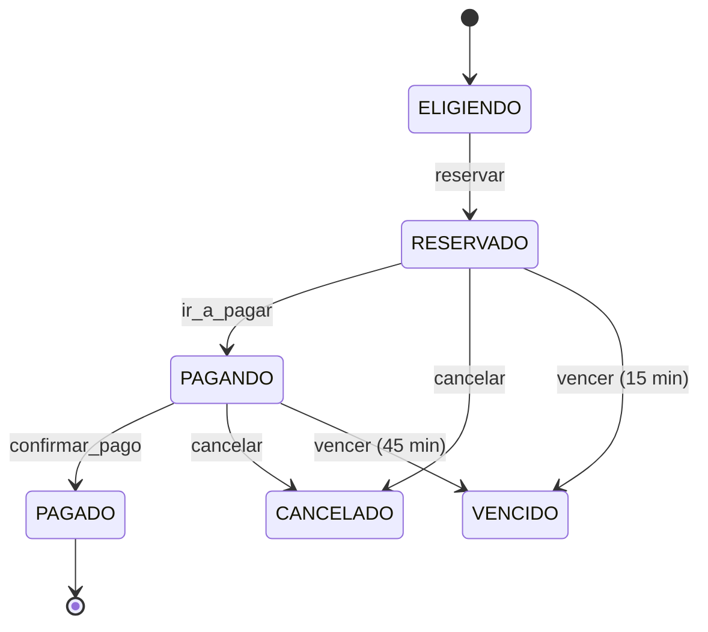
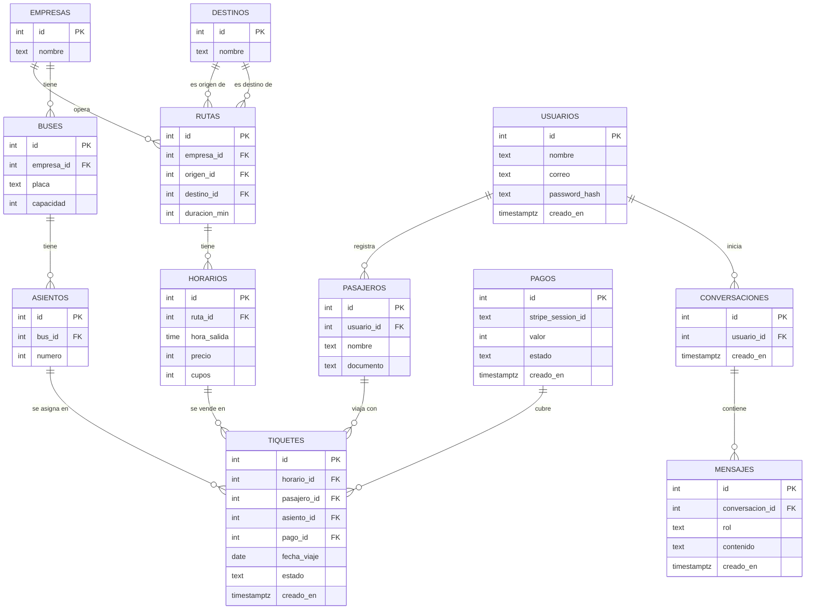
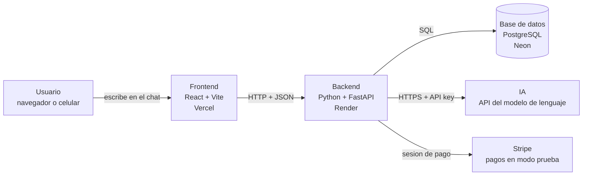
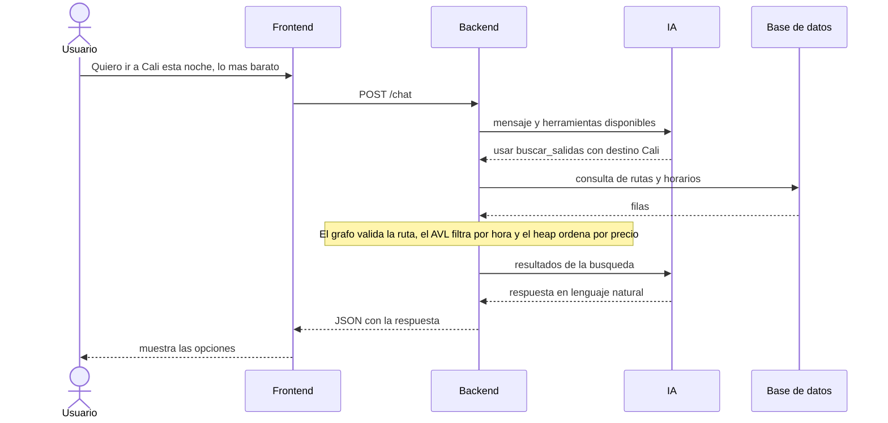

# TerminAPP - Backend

Plataforma para consultar y comprar pasajes de la Terminal de Transportes de Pasto por medio de un chat.
Proyecto final de Estructuras de Datos - Universidad Cooperativa de Colombia, sede Pasto.

## Caso de estudio

**El problema.** Para saber qué buses salen de la Terminal de Transportes de Pasto, a qué hora y cuánto cuestan, hoy una persona tiene que ir hasta la terminal, llamar a cada empresa o revisar varias páginas de venta que no siempre coinciden entre sí. La página oficial de la terminal publica las empresas y los destinos, pero no los horarios ni las tarifas en un solo lugar.

**El usuario.** Personas que viajan desde Pasto hacia municipios de Nariño y hacia ciudades como Cali, Mocoa o Bogotá: estudiantes, trabajadores y familias que necesitan comparar opciones rápido y que no siempre tienen experiencia usando aplicaciones.

**Por qué la IA ayuda.** El usuario escribe como habla, por ejemplo "quiero ir a Cali esta noche, lo más barato", y la IA convierte esa frase en una búsqueda concreta: destino, hora y forma de ordenar. La búsqueda la resuelven las estructuras de datos del backend, y la IA devuelve el resultado en lenguaje natural y guía la compra. Así nadie tiene que aprender a usar filtros ni formularios.

## Integrantes
- Juan David Moreno
- Felipe Alejandro Cerón

## URLs
- Backend: https://terminapp-backend.onrender.com
- Frontend: https://terminapp-frontend.vercel.app
- Repositorio frontend: https://github.com/terminapp-pasto/terminapp-frontend

## Tecnologías
Python, FastAPI, PostgreSQL (Neon), Gemini (IA), Render.

## Endpoints
| Método | Ruta | Qué hace |
|---|---|---|
| GET | `/salud` | Comprueba la conexión con la base de datos |
| GET | `/buscar?destino=Cali&desde=18:00&ordenar_por=precio` | Busca salidas desde Pasto |
| GET | `/destinos` | Lista los destinos con rutas desde Pasto |
| POST | `/chat` | Recibe la conversación y responde con la IA y las salidas encontradas |
| POST | `/registro` | Crea una cuenta (la contraseña se guarda cifrada con PBKDF2) y devuelve un token |
| POST | `/inicio-sesion` | Comprueba correo y contraseña y devuelve un token JWT válido por 24 horas |
| GET | `/yo` | 🔒 Ruta protegida: devuelve el usuario dueño del token (`Authorization: Bearer <token>`) |
| GET | `/horarios/{id}/asientos?fecha=AAAA-MM-DD` | Mapa de los 40 asientos de una salida en una fecha |
| POST | `/compras` | 🔒 Aparta de 1 a 5 asientos por 15 minutos |
| POST | `/compras/{pago_id}/pagar` | 🔒 Crea la página de pago de Stripe (modo prueba) |
| GET | `/compras/confirmar?session_id=...` | 🔒 Pregunta a Stripe si se pagó y confirma los tiquetes |
| POST | `/compras/{pago_id}/cancelar` | 🔒 Cancela una compra sin pagar y libera los asientos |
| GET | `/mis-tiquetes?orden=recientes` | 🔒 Historial de tiquetes del usuario |

## Cómo correrlo en local
1. Crear el archivo `.env` con `DATABASE_URL`, `GEMINI_API_KEY`, `CLAVE_TOKENS`, `STRIPE_SECRET_KEY` y `FRONTEND_URL` (nunca se sube a Git).
2. Activar el entorno: `.\venv\Scripts\Activate.ps1`
3. Encender el servidor **en el puerto 8001**, para no chocar con otros proyectos que usan el 8000:
   ```
   uvicorn main:app --reload --port 8001
   ```
4. Abrir http://127.0.0.1:8001/docs

## Estructuras de datos

Las 10 estructuras están hechas desde cero en la carpeta `estructuras/`, con nodos enlazados propios (sin usar listas ni diccionarios de Python como estructura).

| # | Estructura | Archivo | Para qué se usa en TerminAPP | Complejidad |
|---|---|---|---|---|
| 1 | Grafo dirigido y ponderado (lista de adyacencia) | `grafo.py` | Municipios como vértices y rutas como aristas con la duración; responde "¿hay ruta de Pasto a X?" | Buscar vértice O(V), recorrer rutas de un vértice O(grado) |
| 2 | Matriz con nodos enlazados | `matriz.py` | Matriz de tiempos de viaje entre municipios, construida desde el grafo | Acceso O(f + c) |
| 3 | Árbol AVL | `avl.py` | Horarios de una ruta ordenados por hora; "desde las 18:00" sin revisar todos | Insertar y buscar O(log n) |
| 4 | Montículo mínimo (heap) | `heap.py` | Ordena las salidas encontradas por hora o por precio | Insertar y extraer O(log n) |
| 5 | Árbol n-ario | `nario.py` | Jerarquía terminal → empresas → rutas → horarios | Recorrido O(n) |
| 6 | Tabla hash con encadenamiento | `tabla_hash.py` | Mapa de asientos de un bus (número → LIBRE/OCUPADO) | Insertar, buscar y eliminar O(1) promedio |
| 7 | Pila | `pila.py` | Deshacer: si al reservar varios asientos uno ya está ocupado, se liberan los anteriores en orden inverso | Apilar y desapilar O(1) |
| 8 | Cola | `cola.py` | Reservas pendientes por orden de llegada; las que pasan de 15 minutos sin pagar se vencen | Encolar y desencolar O(1) |
| 9 | Máquina de estados | `maquina_estados.py` | Ciclo de vida del tiquete: ELIGIENDO → RESERVADO → PAGANDO → PAGADO, o CANCELADO / VENCIDO | Transición O(t) |
| 10 | Lista doblemente enlazada | `lista_doble.py` | Historial "Mis tiquetes", recorrible de los más recientes a los más antiguos y al revés | Agregar y quitar O(1), recorrer O(n) |



## Base de datos

Diagrama entidad-relación de las 12 tablas en PostgreSQL. Las 5 primeras sostienen la búsqueda; las demás, la autenticación, la compra, el pago y el chat con la IA.


## Arquitectura

TerminAPP tiene cuatro capas. El frontend solo habla con el backend, y el backend es el único que habla con la base de datos, con la IA y con Stripe. Las claves viven en variables de entorno del backend, nunca en el frontend ni en Git.



### Recorrido de una petición


