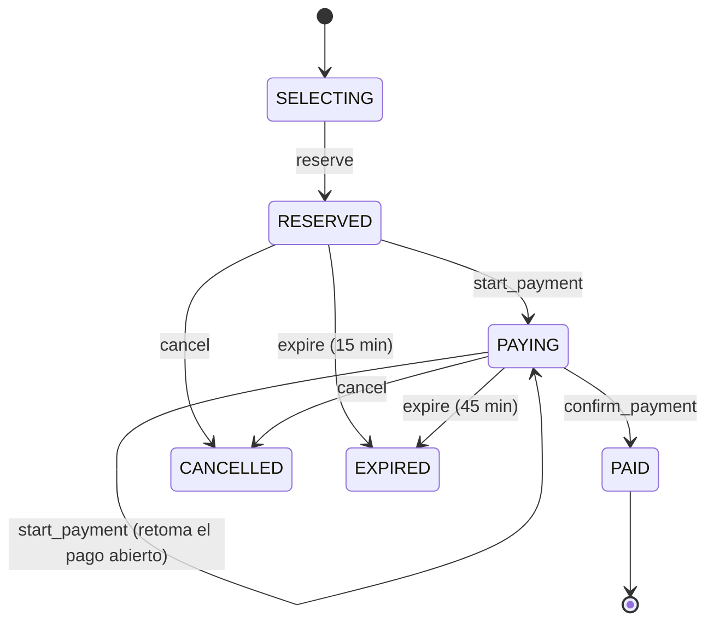
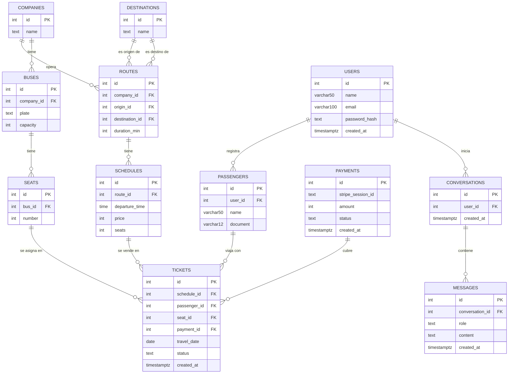
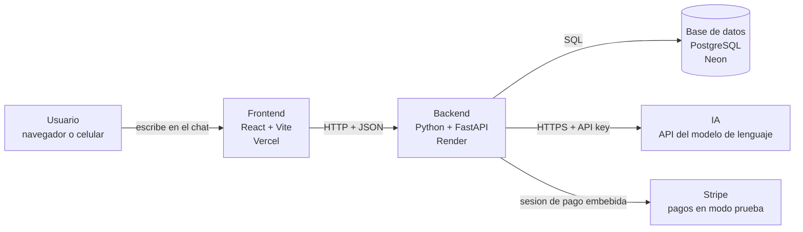
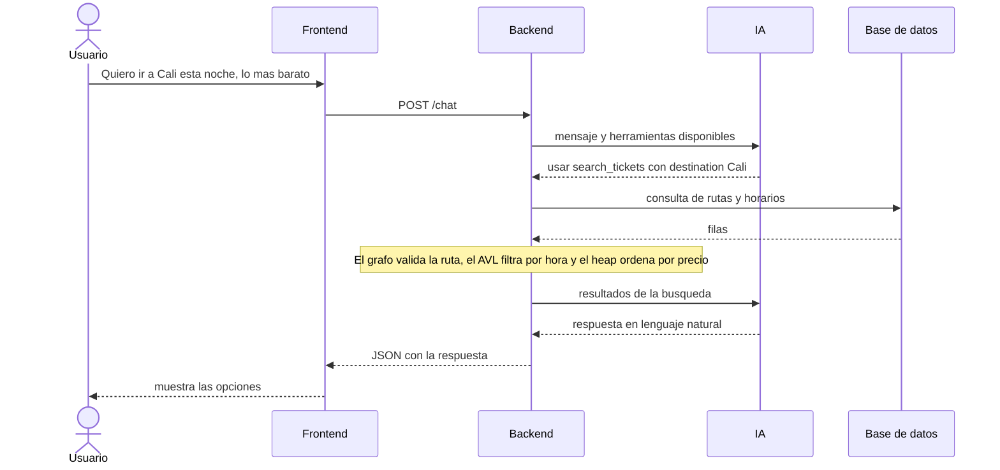

# TerminAPP - Backend

Plataforma para consultar y comprar pasajes de la Terminal de Transportes de Pasto por medio de un chat.
Proyecto final de Estructuras de Datos - Universidad Cooperativa de Colombia, sede Pasto.

## Caso de estudio

**El problema.** Para saber qué buses salen de la Terminal de Transportes de Pasto, a qué hora y cuánto cuestan, hoy una persona tiene que ir hasta la terminal, llamar a cada empresa o revisar varias páginas de venta que no siempre coinciden entre sí. La página oficial de la terminal publica las empresas y los destinos, pero no los horarios ni las tarifas en un solo lugar.

**El usuario.** Personas que viajan desde Pasto hacia municipios de Nariño y hacia ciudades como Cali, Mocoa o Bogotá: estudiantes, trabajadores y familias que necesitan comparar opciones rápido y que no siempre tienen experiencia usando aplicaciones.

**Por qué la IA ayuda.** El usuario escribe como habla, por ejemplo "quiero ir a Cali esta noche, lo más barato", y la IA convierte esa frase en una búsqueda concreta: destino, hora y forma de ordenar. La búsqueda la resuelven las estructuras de datos del backend, y la IA devuelve el resultado en lenguaje natural y guía la compra. Así nadie tiene que aprender a usar filtros ni formularios.

## Integrantes
- Juan David Moreno
- Felipe Alejandro Cerón

## URLs
- Backend: https://terminapp-backend.onrender.com
- Frontend: https://terminapp-frontend.vercel.app
- Repositorio frontend: https://github.com/terminapp-pasto/terminapp-frontend

## Tecnologías
Python, FastAPI, PostgreSQL (Neon), Gemini (IA), Render.

## Organización del código

```
config.py            todas las variables de entorno (nada queda quemado en el código)
main.py              arma la aplicación y une las rutas
routes/              rutas HTTP: system, search, chat, auth, purchases
services/            lógica: búsqueda, compra, usuarios, fechas, validación, base de datos
structs/             las 10 estructuras de datos hechas desde cero
authentication/      utilities.py (cifrar y verificar contraseñas) y tokens.py (JWT)
ai/                  gemini.py (proveedor), tools.py (herramientas), orchestrator.py (el chat)
payments/            stripe_client.py (pago embebido de Stripe en modo prueba)
db/                  scripts SQL 01 a 05
tests/               pruebas automáticas
```

## Endpoints
| Método | Ruta | Qué hace |
|---|---|---|
| GET | `/health` | Comprueba la conexión con la base de datos |
| GET | `/search?destination=Cali&date=2026-10-24&from_time=18:00&sort_by=price` | Busca salidas desde Pasto para un día, con los cupos libres de ese día |
| GET | `/destinations` | Lista los destinos con rutas desde Pasto |
| POST | `/chat` | Recibe la conversación (`{"messages": [{"role": "user", "text": "..."}]}`) y responde con la IA y las salidas encontradas |
| POST | `/register` | Crea una cuenta (la contraseña se guarda cifrada con PBKDF2) y devuelve un token |
| POST | `/login` | Comprueba correo y contraseña y devuelve un token JWT válido por 24 horas |
| GET | `/me` | 🔒 Ruta protegida: devuelve el usuario dueño del token (`Authorization: Bearer <token>`) |
| GET | `/schedules/{id}/seats?date=AAAA-MM-DD` | Mapa de los 40 asientos de una salida en una fecha |
| POST | `/purchases` | 🔒 Aparta de 1 a 5 asientos por 15 minutos, con los datos de un pasajero por asiento |
| POST | `/purchases/{payment_id}/pay` | 🔒 Prepara el pago embebido de Stripe; si ya hay uno abierto, lo reutiliza |
| GET | `/purchases/confirm?session_id=...` | 🔒 Pregunta a Stripe si se pagó y confirma los tiquetes |
| POST | `/purchases/{payment_id}/cancel` | 🔒 Cancela una compra sin pagar y libera los asientos |
| GET | `/my-tickets?order=newest` | 🔒 Historial de compras del usuario (`newest` u `oldest`) |

## Reglas de la compra
- **Un pasajero por asiento.** Si se compran 3 asientos se piden 3 nombres y 3 documentos.
- **Validación con expresiones regulares** (en el frontend y otra vez en el backend, `services/validation.py`):
  nombre solo letras y espacios, de 3 a 50 caracteres; documento solo números, de 5 a 12 dígitos;
  correo de máximo 100 caracteres; contraseña de 8 a 72. Un texto gigante se rechaza antes de llegar a la base de datos.
- **Dos personas y el último asiento.** Al reservar se bloquea la salida (`SELECT ... FOR UPDATE`): PostgreSQL pone en fila
  (FIFO) las demás reservas de esa salida, la primera gana y la segunda recibe "El asiento 40 acaba de ser ocupado".
  Además, el índice único `unique_seat_per_trip` impide que un asiento quede vendido dos veces. La prueba
  `test_two_people_take_the_last_seat_at_the_same_time` lo demuestra con dos reservas al mismo instante.
- **Nunca dos pagos en proceso para el mismo viaje.** Si el usuario vuelve atrás y reserva otra vez la misma salida,
  la compra pendiente anterior se cancela y su sesión de Stripe se cierra. Al pagar, si ya hay una sesión abierta se reutiliza.
- **El pago se confirma preguntándole a Stripe**, no confiando en que el usuario volvió a la página.

## Cómo correrlo en local
1. Copiar `.env.example` como `.env` y llenar `DATABASE_URL`, `GEMINI_API_KEY`, `TOKEN_SECRET`, `STRIPE_SECRET_KEY` y `FRONTEND_URL` (nunca se sube a Git).
2. Activar el entorno: `.\venv\Scripts\Activate.ps1`
3. Encender el servidor **en el puerto 8001**, para no chocar con otros proyectos que usan el 8000:
   ```
   uvicorn main:app --reload --port 8001
   ```
4. Abrir http://127.0.0.1:8001/docs

## Estructuras de datos

Las 10 estructuras están hechas desde cero en la carpeta `structs/`, con nodos enlazados propios (sin usar listas ni diccionarios de Python como estructura).

| # | Estructura | Archivo | Para qué se usa en TerminAPP | Complejidad |
|---|---|---|---|---|
| 1 | Grafo dirigido y ponderado (lista de adyacencia) | `graph.py` | Municipios como vértices y rutas como aristas con la duración; responde "¿hay ruta de Pasto a X?" | Buscar vértice O(V), recorrer rutas de un vértice O(grado) |
| 2 | Matriz con nodos enlazados | `matrix.py` | Tabla de la distancia de edición para corregir destinos mal escritos ("bodota" → Bogotá) y matriz de tiempos entre municipios | Acceso O(f + c); corrección O(n·m·(n+m)) |
| 3 | Árbol AVL | `avl_tree.py` | Horarios de una ruta ordenados por hora; "desde las 18:00" sin revisar todos | Insertar y buscar O(log n) |
| 4 | Montículo de mínimos (heap) | `min_heap.py` | Ordena las salidas encontradas por hora o por precio | Insertar y extraer O(log n) |
| 5 | Árbol n-ario | `nary_tree.py` | Jerarquía terminal → empresas → rutas → horarios | Recorrido O(n) |
| 6 | Tabla hash con encadenamiento | `hash_table.py` | Mapa de asientos de un bus (número → FREE/TAKEN) y agrupar el historial por compra | Insertar, buscar y eliminar O(1) promedio |
| 7 | Pila | `stack.py` | Deshacer: si al reservar varios asientos uno ya está ocupado, se liberan los anteriores en orden inverso | Apilar y desapilar O(1) |
| 8 | Cola | `queue.py` | Reservas pendientes por orden de llegada; las que pasan de 15 minutos sin pagar se vencen | Encolar y desencolar O(1) |
| 9 | Máquina de estados | `state_machine.py` | Ciclo de vida del tiquete: SELECTING → RESERVED → PAYING → PAID, o CANCELLED / EXPIRED | Transición O(t) |
| 10 | Lista doblemente enlazada | `doubly_linked_list.py` | Historial de compras, recorrible de las más recientes a las más antiguas y al revés | Agregar y quitar O(1), recorrer O(n) |



### Pruebas automáticas

La carpeta `tests/` tiene 77 pruebas: las 10 estructuras, la autenticación, las fechas, la validación de formularios
y la compra contra una base de datos real. Las pruebas de la compra no prueban solo el camino feliz: asiento ocupado,
datos inválidos o gigantes, otro usuario tocando mi compra, cancelar, vencer, pagar dos veces y **dos personas pidiendo
el último asiento al mismo tiempo**.

Se corren con el entorno activado:

```
python -m unittest discover -s tests -v
```

Las 11 pruebas de la compra necesitan una base **vacía y desechable** (por ejemplo una rama de Neon llamada `pruebas`),
porque borran y vuelven a crear las tablas. Sin esa variable se saltan (salen como `skipped`):

```
$env:TEST_DATABASE_URL="postgresql://...rama-de-pruebas..."
python -m unittest tests.test_purchases_database -v
```

Si todo está bien, al final sale `OK`.

## Base de datos

Diagrama entidad-relación de las 12 tablas en PostgreSQL (nombres en inglés). Una base nueva se crea con los scripts `db/01` a `db/04`; una base que ya existía en español se pasa a inglés, sin perder datos, con `db/05_translate_to_english.sql`. Las 5 primeras sostienen la búsqueda; las demás, la autenticación, la compra, el pago y el chat con la IA.


## Arquitectura

TerminAPP tiene cuatro capas. El frontend solo habla con el backend, y el backend es el único que habla con la base de datos, con la IA y con Stripe. Las claves viven en variables de entorno del backend, nunca en el frontend ni en Git.



### Recorrido de una petición


